# JARVIS

JARVIS is a local, voice-driven assistant that listens for a wake word, transcribes speech, asks a local Ollama model for a response, and speaks the answer aloud. It also has optional voice and face enrollment for speaker verification and camera-based presence greetings; this project does not currently control the computer, browse the web, or operate smart-home devices.

**Demo video:** [Add demo video link](#)

## Current features

The following behavior is implemented in the current source:

- Listens for the configured OpenWakeWord keyword (`hey_jarvis` by default) or a double clap to start a session.
- Transcribes microphone audio locally with a Sherpa-ONNX streaming transducer model, showing partial text while listening.
- Checks whether the utterance is addressed to JARVIS using the configured Ollama chat model. If no voice profile exists, or voice verification errors, the app accepts the utterance.
- Streams the Ollama response sentence by sentence into Qwen TTS audio generation and plays the audio through a serialized audio manager. The default custom voice does not require a reference recording; a reference clip can be configured for voice cloning when `JARVIS_TTS_MODEL` is set to a compatible voice-cloning model.
- Monitors microphone energy while speaking and interrupts playback when sustained sound exceeds a calibrated threshold. This is an energy gate, not acoustic echo cancellation.
- Ends a session after repeated empty or rejected input, or when an exit phrase is spoken.
- Creates `memory/memory.json` on startup, uses its saved facts as context in later sessions, and asks Ollama to distill session transcripts into durable facts when each session ends. Memory is stored locally.
- Can optionally greet an enrolled person when the camera detects their face. Camera presence is disabled unless detector assets and an enrolled face model are available.
- Includes scripts to enroll a voice profile and face model. These are local biometric artifacts and are excluded by `.gitignore`.

The code in `computer/`, `hardware/`, `tools/`, `ui/`, and `vision/` is currently empty scaffolding. Those modules do not provide working controls or interfaces yet. `whisper_streaming` is not used by the active transcription path; current ASR uses Sherpa-ONNX.

## Architecture

```mermaid
flowchart TD
    Main[main.py: session and event loop]
    Audio[core/audio_manager.py: serialized playback]
    Brain[core/brain.py: Ollama chat and addressed check]
    Memory[core/memory.py: local facts and session distillation]
    Filler[core/filler.py: short lead-in phrases]
    Wake[voice/wakeword.py: OpenWakeWord]
    ASR[voice/listen.py: Sherpa-ONNX transcription]
    TTS[voice/speak.py: Qwen speech generation]
    Clap[listeners/clap_detector.py: double-clap trigger]
    Barge[listeners/barge_in.py: playback interruption]
    SpeakerID[listeners/speaker_id.py: optional voice profile check]
    Camera[camera/camera_presence.py: face detection and presence]
    Enroll[camera/enroll_face.py and listeners/enroll_voice.py]
    Ollama[(Ollama service)]
    Models[(Downloaded ASR and TTS models)]
    Mic[(Microphone)]
    Speakers[(Audio output)]
    Webcam[(Webcam)]

    Main --> Wake
    Main --> Clap
    Main --> ASR
    Main --> SpeakerID
    Main --> Brain
    Main --> Memory
    Main --> Filler
    Main --> TTS
    Main --> Barge
    Main --> Camera
    ASR --> Mic
    Wake --> Mic
    Clap --> Mic
    SpeakerID --> Mic
    Barge --> Mic
    TTS --> Speakers
    Audio --> Speakers
    Brain --> Ollama
    Memory --> Ollama
    ASR --> Models
    TTS --> Models
    Camera --> Webcam
    Enroll -. creates local profiles .-> SpeakerID
    Enroll -. creates local face model .-> Camera
```



`main.py` wires the long-running session loop. `core/` handles conversation, memory, fillers, and audio playback. `voice/` contains wake-word detection, transcription, and speech generation. `listeners/` contains clap detection, barge-in monitoring, and optional speaker verification. `camera/` implements optional face presence detection and enrollment.

## Tech stack

- Python 3.10 or 3.11
- [Sherpa-ONNX](https://github.com/k2-fsa/sherpa-onnx) for streaming speech recognition
- [OpenWakeWord](https://github.com/dscripka/openWakeWord) and `sounddevice` for wake-word and microphone input
- [Ollama](https://ollama.com/) for local chat and memory distillation
- [faster-qwen3-tts](https://github.com/andimarafioti/faster-qwen3-tts) and PyTorch for speech generation
- NumPy and [Resemblyzer](https://github.com/resemble-ai/Resemblyzer) for optional speaker verification
- OpenCV contrib for face detection and LBPH face recognition
- `python-dotenv` for optional `.env` configuration

The `whisper_streaming` project is an optional external alternative, not part of the active runtime or dependency list.

## Setup and run

### 1. Install Python and dependencies

Install Python 3.10 or 3.11. Create a virtual environment in the project directory and install a PyTorch build appropriate for your hardware using the [official PyTorch selector](https://pytorch.org/get-started/locally/). Then install the project requirements:

```powershell
py -3.10 -m venv .venv
.venv\Scripts\Activate.ps1
python -m pip install --upgrade pip
pip install -r requirements.txt
```

The TTS package requires PyTorch; installing a CPU or CUDA build that matches your system is a machine-specific step. See the [faster-qwen3-tts setup notes](https://github.com/andimarafioti/faster-qwen3-tts) if installation needs additional configuration.

### 2. Configure Ollama

Install and start [Ollama](https://ollama.com/), then pull the default chat model:

```powershell
ollama pull llama3.2:3b-instruct-q4_K_M
```

If you select a different value for `JARVIS_OLLAMA_MODEL`, pull that model instead.

### 3. Download the speech recognition model

Download a compatible streaming transducer model from the [Sherpa-ONNX model catalog](https://k2-fsa.github.io/sherpa/onnx/pretrained_models/index.html). Set `JARVIS_SHERPA_MODEL_DIR` in `.env` to its directory. The configured directory must contain `tokens.txt`, `encoder.onnx`, `decoder.onnx`, and `joiner.onnx`. Model weights are not included in this repository; review the model license before redistributing them.

### 4. Configure and start

Copy the example configuration and adjust it as needed:

```powershell
Copy-Item .env.example .env
```

Set `JARVIS_USER_NAME` and optional `JARVIS_USER_DETAILS` if desired. Defaults use the generic name `friend`. Then start the assistant:

```powershell
python main.py
```

On startup, JARVIS creates an empty local memory file if needed and loads its TTS model. The microphone and speakers must be available. Without the optional voice profile, speaker verification accepts speech. Without camera detector assets and an enrolled face model, camera-based greetings remain disabled.

### Optional: enroll voice and face

- **Voice verification:** run `python listeners/enroll_voice.py` and follow the prompts. At least three usable recordings are required. The script saves a voice embedding to `listeners/voice_profile.npy` by default.
- **Face presence:** download OpenCV's `deploy.prototxt` and matching `res10_300x300_ssd_iter_140000.caffemodel` detector assets from the [OpenCV repository](https://github.com/opencv/opencv/tree/4.x/samples/dnn/face_detector) and [OpenCV 3rd-party assets](https://github.com/opencv/opencv_3rdparty). Set the detector paths in `.env`, then run `python camera/enroll_face.py`. Capture at least five varied frames and press Escape to train and save the face model.

Paths, names, model IDs, and optional TTS reference audio are documented in `.env.example`. Keep `.env`, generated memory, and enrollment files private.

## Roadmap

These are planned or potential follow-ups, not features available today:

- Implement the empty `tools/`, `computer/`, and `hardware/` modules before describing or exposing any actions.
- Build a user interface for status, settings, and conversation feedback; the current application is terminal-driven.
- Add vision and screen understanding in `vision/` with explicit user controls.
- Improve microphone stream sharing and barge-in behavior across devices and acoustic setups.
- Add memory management controls, including review, editing, and deletion of saved facts.
- Add setup checks and clearer diagnostics for audio devices, model files, and optional camera assets.

